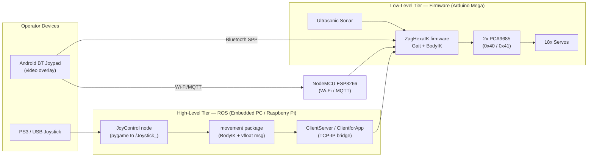

<div align="center">

# ZagHexa — ROS-Based 18-DOF Hexapod Walking Robot

**An integrated, six-legged walking robot built on the Robot Operating System (ROS), featuring closed-loop inverse-kinematics control, multiple biologically-inspired gaits, and multi-channel teleoperation over Bluetooth, Wi-Fi, and wireless joystick.**

[](https://www.ros.org/)
[](https://www.arduino.cc/)
[]()
[]()

[View the Project on GitHub](https://github.com/RoboZag/zagHexa) · [Project Documentation Site](https://robozag.github.io/zagHexa/)

</div>

---

## Table of Contents

- [Overview](#overview)
- [Key Features](#key-features)
- [System Architecture](#system-architecture)
- [Hardware](#hardware)
- [Kinematic Model](#kinematic-model)
- [Locomotion: Gaits and Motion Modes](#locomotion-gaits-and-motion-modes)
- [Software Components](#software-components)
- [Repository Structure](#repository-structure)
- [Getting Started](#getting-started)
  - [Prerequisites](#prerequisites)
  - [Building the Firmware](#building-the-firmware)
  - [Building the ROS Workspace](#building-the-ros-workspace)
  - [Running the Simulation](#running-the-simulation)
- [Teleoperation](#teleoperation)
  - [Control Command Protocol](#control-command-protocol)
  - [Bluetooth Control (Android)](#bluetooth-control-android)
  - [Wi-Fi Control (NodeMCU / MQTT)](#wi-fi-control-nodemcu--mqtt)
  - [Joystick Control (PS3 / Pygame)](#joystick-control-ps3--pygame)
- [MATLAB Modeling & Simulation](#matlab-modeling--simulation)
- [Communication Layer](#communication-layer)
- [Documentation Site](#documentation-site)
- [Contributing](#contributing)
- [License](#license)
- [Acknowledgements](#acknowledgements)

---

## Overview

**ZagHexa** is a fully integrated multi-legged walking robot that employs novel and configurable walking
patterns and is capable of the core mobility tasks expected of a hexapod platform:

- Walking forward and backward
- Strafing / turning and rotating in place
- Raising and lowering the body height
- Body pose adjustment (translation and rotation about all three axes)

The robot is teleoperated using hand-held devices such as a smartphone, tablet, or a wireless joystick.
It carries its own on-board navigation stack and a camera for live video recording and streaming.

The platform is deliberately split into two cooperating computation tiers:

1. **High-level tier (ROS on an embedded PC / Raspberry Pi):** runs the ROS graph, joystick handling,
   TCP/IP communication, and command generation.
2. **Low-level tier (Arduino Mega firmware):** executes the body inverse-kinematics (IK), gait
   generation, and precise servo actuation through PCA9685 PWM drivers.

---

## Key Features

- **18 Degrees of Freedom** — six legs × three joints (Coxa / Femur / Tibia) per leg.
- **Full-body inverse kinematics** — 6-DoF body pose control (`PosX, PosY, PosZ, RotX, RotY, RotZ`).
- **Multiple gaits** — Tripod, Wave, and Ripple, switchable on the fly.
- **Multiple motion modes** — Normal, translation (XY), rotation (XY), and combined Z-translate/rotate.
- **Variable-speed servo motion** — smooth interpolated joint motion via `VarSpeedServo`.
- **Multi-channel teleoperation** — Bluetooth (HC-05 + Android app), Wi-Fi (NodeMCU / MQTT), and PS3-style joystick.
- **Obstacle sensing** — ultrasonic sonar module for range measurement.
- **Live video** — camera streaming with IP Webcam overlay integration in the Android controller.
- **Simulation** — MATLAB kinematic modeling and RViz/Gazebo visualization models.
- **Reusable Arduino libraries** — kinematics, gait, and servo-driver code packaged for reuse.

---

## System Architecture



**Control flow.** Operator input arrives from one of three channels. Bluetooth/Wi-Fi commands are single-character
opcodes consumed directly by the firmware; joystick input is published to ROS topics, processed into pose/gait
commands, and relayed to the Arduino over the TCP/IP bridge. The firmware resolves the requested body pose through
inverse kinematics, generates the active gait cycle, and drives the servos via the PCA9685 controllers.

---

## Hardware

| Subsystem | Component | Notes |
|-----------|-----------|-------|
| Legs | 6 legs x 3 joints | Coxa (rotation), Femur (lift), Tibia — 18 actuators total |
| Actuation | 18x hobby servos | Driven at 50 Hz PWM; pulse range `SERVOMIN = 150` … `SERVOMAX = 550` |
| Servo drivers | 2x PCA9685 (I2C `0x40`, `0x41`) | 16-channel PWM each; spans all 18 channels |
| Low-level MCU | Arduino Mega 2560 | Runs IK + gait firmware |
| High-level compute | Embedded PC / Raspberry Pi | Runs the ROS graph |
| Wireless (BT) | HC-05 Bluetooth module | Serial SPP link on `SoftwareSerial(11, 12)` |
| Wireless (Wi-Fi) | NodeMCU ESP8266 | MQTT client (broker port `1883`) |
| Sensing | Ultrasonic sonar | Range measurement / obstacle detection |
| Vision | IP camera | Streamed and overlaid in the Android app |

### Servo Channel Map (Arduino Mega direct-pin option)

| Leg | Rotation | Lift | Tibia |
|-----|:--------:|:----:|:-----:|
| Right Front | 23 | 25 | 27 |
| Right Middle | 29 | 31 | 33 |
| Right Rear | 35 | 37 | 39 |
| Left Front | 22 | 24 | 26 |
| Left Middle | 28 | 30 | 32 |
| Left Rear | 34 | 36 | 38 |

> When using the PCA9685 drivers, joints are addressed by logical index `0…17`
> (`RightFrontRot = 0` … `LeftRearTibia = 17`) as defined in the firmware headers.

---

## Kinematic Model

Each leg is a 3-link serial chain — **Coxa → Femur → Tibia** — and the body is modeled as a regular hexagon.
The IK solver accepts a full 6-DoF body target and computes the 18 joint angles required to place the six feet
correctly relative to the body frame.

Configurable body/leg dimensions (see [`library/BodIK/src/BodyIK.h`](library/BodIK/src/BodyIK.h)):

| Parameter | Symbol | Reference value |
|-----------|--------|-----------------|
| Coxa length | `Coxa` | 25.0 mm |
| Femur length | `Femur` | 76.0 mm |
| Tibia length | `Tibia` | 112.0 mm |
| Body side length | `BodySideLength` | 75.0 mm |

Body center offsets are derived from the body side length:

$$
\text{BodyCenterOffset1} = \frac{\text{BodySideLength}}{2}, \qquad
\text{BodyCenterOffset2} = \sqrt{\text{BodySideLength}^2 - \text{BodyCenterOffset1}^2}
$$

The primary entry point is:

```cpp
void clacHexaBodyIK(float PosX, float PosY, float PosZ,
                    float RotX, float RotY, float RotZ);
```

which populates the per-leg joint angle set (`IKangles[0..5]`), retrievable through `correct_angle(legNum)`.
Leg indexing runs `0 = RightFront, 1 = RightMiddle, 2 = RightRear, 3 = LeftFront, 4 = LeftMiddle, 5 = LeftRear`.

> **Note on dimensions:** reference implementations in the repository use slightly different link lengths
> (e.g. `Coxa = 12, Femur = 35, Tibia = 72` in some ROS test drivers). Always set the constants to match
> your physical build before deploying.

---

## Locomotion: Gaits and Motion Modes

The firmware supports three switchable gaits and four motion modes.

### Gaits (`Wmode`)

| Value | Gait | Description |
|:-----:|------|-------------|
| `0` | **Tripod** | Two alternating tripods (3 legs each) — fastest, statically stable |
| `1` | **Wave** | One leg swings at a time — slowest, most stable |
| `2` | **Ripple** | Overlapping leg phases — balance of speed and stability |

### Motion Modes (`Mode`)

| Value | Mode | Description |
|:-----:|------|-------------|
| `0` | **NM** — Normal | Standard walking |
| `1` | **XYT** | Body translation in the XY plane |
| `2` | **XYR** | Body rotation about the XY axes |
| `3` | **ZTR** | Body Z-translation and rotation |

### Speed

Servo speed is expressed as a `velocity` value passed to `VarSpeedServo`:
`0` = full speed (instant), `1` = minimum speed, `255` = maximum interpolated speed.
A discrete `speedLevel` (1–4) is exposed to the operator and mapped to servo velocity by `speedSet()`.

---

## Software Components

### Arduino Libraries (`library/`)

| Library | Purpose |
|---------|---------|
| [`BodIK`](library/BodIK) | Full-body inverse kinematics (`BodyIk` class), calibration, leg & body pose computation |
| [`Movement`](library/Movement) | Gait patterns (`Walking_Patterns`) and the `ZagHexa_servodriver` PCA9685 driver |
| [`WalkingPattern`](library/WalkingPattern) | Higher-level `walkingPattern` gait/motion orchestration used by the firmware |
| [`VarSpeedServo`](library/VarSpeedServo) | Interpolated, variable-speed servo actuation |
| [`pubsubclient`](library/pubsubclient) | MQTT client used by the NodeMCU Wi-Fi firmware |

### Firmware (`ArduinoCode/`, `ZagHexaIKBluetooth/`, `ZagHexaIKWiFi/`)

- [`ZagHexaIKBluetooth/ZagHexaIK/ZagHexaIK.ino`](ZagHexaIKBluetooth/ZagHexaIK/ZagHexaIK.ino) — main Bluetooth firmware
  (parses single-char commands, drives gait + IK). Companion modules: `normalMode`, `rotaXY`, `transXY`,
  `transAndrotaZ`, `Speed`.
- [`ZagHexaIKWiFi/NodeMCU/MQTT_Client`](ZagHexaIKWiFi/NodeMCU/MQTT_Client) — ESP8266 MQTT client: subscribes to
  topic `ZagHexa` for commands, publishes replies on `OutTopic`.
- [`ArduinoCode/tripod/tripod.ino`](ArduinoCode/tripod/tripod.ino) — standalone tripod-gait reference and
  incremental development variants (`tripod_gp`, `tripod_sc`, `ZagHexa_mega`, `ZagHexa_mega_IK`, …).
- [`ArduinoCode/Sonar`](ArduinoCode/Sonar) — ultrasonic range-sensing firmware.

### ROS Packages (`ROS/src/`)

| Package | Description |
|---------|-------------|
| [`movement`](ROS/src/movement) | Core node linking against `BodyIK`; defines the custom `vfloat` message and the `JoyControl.py` node |
| [`ClientServer`](ROS/src/ClientServer) | TCP/IP `server_node` / `client_node` bridging ROS topics to socket streams |
| [`ClientforApp`](ROS/src/ClientforApp) | Client that relays commands from the mobile app into the ROS graph |

Custom message — [`ROS/src/movement/msg/vfloat.msg`](ROS/src/movement/msg/vfloat.msg):

```
Header header
float32[] data
```

### Simulation & Modeling

- [`Matlab/`](Matlab) — kinematic modeling, gait trajectory generation, forward/inverse kinematics, and animation.
- [`rviz/zaghexa_sim/`](rviz/zaghexa_sim) — RViz/Gazebo URDF, meshes, and launch files for visualization.

### Mobile Application (`androidRobotBTjoystick/`)

A configurable Bluetooth joypad Android app with 4-direction + 4-button layout, live IP-Webcam video overlay,
QR-code quick configuration, click vibration, and a debug mode.

---

## Repository Structure

```
zagHexa/
├── ArduinoCode/            # Standalone firmware sketches (tripod gait, sonar, mega variants)
├── Apks/                   # Prebuilt Android controller APKs
├── androidRobotBTjoystick/ # Android Bluetooth joypad app (Gradle project)
├── Client_Server/          # Reference C socket client/server
├── docs/                   # Jekyll GitHub Pages documentation site
├── documents/              # Final report, presentation, user manual (LaTeX / media)
├── library/                # Reusable Arduino libraries (BodIK, Movement, WalkingPattern, …)
├── Matlab/                 # Kinematics modeling, gait trajectories, animation scripts
├── publications/           # IEEE / conference paper templates and drafts
├── ROS/                    # Catkin workspace (movement, ClientServer, ClientforApp)
├── rviz/                   # RViz/Gazebo simulation package (zaghexa_sim)
├── ZagHexaIKBluetooth/     # Bluetooth IK firmware (Arduino Mega)
├── ZagHexaIKWiFi/          # Wi-Fi IK firmware (NodeMCU ESP8266 + MQTT)
├── _config.yml             # GitHub Pages (Jekyll) configuration
└── README.md               # This document
```

---

## Getting Started

### Prerequisites

**High-level (ROS) tier**
- Ubuntu with a compatible ROS 1 distribution (catkin build system)
- ROS packages: `roscpp`, `rospy`, `std_msgs`, `message_generation` / `message_runtime`
- Python with `pygame` (for joystick control)

**Low-level (firmware) tier**
- Arduino IDE (or `arduino-cli`)
- Bundled libraries from [`library/`](library) installed into your Arduino `libraries` folder:
  `BodIK`, `Movement`, `WalkingPattern`, `VarSpeedServo`, `pubsubclient`
- Adafruit PWM Servo Driver library (PCA9685)
- For the Wi-Fi build: ESP8266 board support package

### Building the Firmware

1. Copy the folders under [`library/`](library) into your Arduino `libraries/` directory.
2. Open the target sketch:
   - **Bluetooth:** [`ZagHexaIKBluetooth/ZagHexaIK/ZagHexaIK.ino`](ZagHexaIKBluetooth/ZagHexaIK/ZagHexaIK.ino)
   - **Wi-Fi:** [`ZagHexaIKWiFi/NodeMCU/MQTT_Client/MQTT_Client.ino`](ZagHexaIKWiFi/NodeMCU/MQTT_Client/MQTT_Client.ino)
3. Select the correct board (Arduino Mega 2560 or NodeMCU 1.0) and serial port.
4. Set your body/leg dimensions in [`library/BodIK/src/BodyIK.h`](library/BodIK/src/BodyIK.h) to match your build.
5. Compile and upload.

> On first power-up the firmware calibrates all joints to their reference (`90°`) positions before standing up.

### Building the ROS Workspace

```bash
# From the repository root, use ROS/ as your catkin workspace
cd ROS
catkin_make
source devel/setup.bash
```

Run the nodes (example):

```bash
# Terminal 1 — ROS master
roscore

# Terminal 2 — TCP server bridging socket traffic to /server_messages/
rosrun ClientServer server_node <port>

# Terminal 3 — joystick controller (publishes to /Joystick_)
rosrun movement JoyControl.py
```

### Running the Simulation

- **MATLAB:** open [`Matlab/zaghexa.m`](Matlab/zaghexa.m) (requires the Robotics / Peter Corke Toolbox for
  `SerialLink`, `Link`, `mstraj`, `ikine`) to generate and animate a leg gait trajectory.
- **RViz/Gazebo:** launch the model from [`rviz/zaghexa_sim/launch`](rviz/zaghexa_sim/launch).

---

## Teleoperation

### Control Command Protocol

The Bluetooth/Wi-Fi firmware is driven by single-character opcodes:

| Command | Action |
|:-------:|--------|
| `f` | Move forward |
| `b` | Move backward |
| `l` | Turn / strafe left |
| `r` | Turn / strafe right |
| `w` | Cycle walking gait (`Wmode`: Tripod → Wave → Ripple) |
| `m` | Cycle motion mode (`Mode`: NM → XYT → XYR → ZTR) |
| `o` | Increase speed level |
| `p` | Decrease speed level |
| `d` | Stop / reset to reference pose |

### Bluetooth Control (Android)

1. Pair the phone with the on-board HC-05 module.
2. Launch the [Android BT joypad](androidRobotBTjoystick) app (prebuilt APKs in [`Apks/`](Apks)).
3. (Optional) Configure the IP-Webcam URL to overlay live video; map buttons via the QR-code scanner.
4. Directional pad and buttons emit the opcodes above over the Bluetooth serial link.

### Wi-Fi Control (NodeMCU / MQTT)

The NodeMCU firmware connects to Wi-Fi and an MQTT broker (`port 1883`), then:

- **Subscribes** to topic `ZagHexa` — incoming command characters.
- **Publishes** to topic `OutTopic` — status / acknowledgements.

Configure SSID, password, and broker address in the sketch before flashing
([`ZagHexaIKWiFi/NodeMCU/MQTT_Client`](ZagHexaIKWiFi/NodeMCU/MQTT_Client)).

### Joystick Control (PS3 / Pygame)

[`ROS/src/movement/src/JoyControl.py`](ROS/src/movement/src/JoyControl.py) initializes a `Joystick_node`,
reads a connected controller via `pygame`, and publishes button events (as `std_msgs/Int8`) to the `Joystick_`
topic for downstream processing. Button mappings follow a PS3-style layout (A/B/X/Y, LB/RB/LT/RT, Back/Start).

---

## MATLAB Modeling & Simulation

The [`Matlab/`](Matlab) directory contains the analytical and simulation groundwork for the platform:

| Script | Purpose |
|--------|---------|
| [`zaghexa.m`](Matlab/zaghexa.m) | Full leg model + gait trajectory generation and animation |
| [`clacHexaBodyIK.m`](Matlab/clacHexaBodyIK.m) / [`ik.m`](Matlab/ik.m) | Body / leg inverse kinematics |
| [`hexapodfk.m`](Matlab/hexapodfk.m) / [`hexapodik.m`](Matlab/hexapodik.m) | Forward & inverse kinematics of the hexapod |
| [`ZagHexaLegModelIK.m`](Matlab/ZagHexaLegModelIK.m) / [`ZagHexaLegModelIF.m`](Matlab/ZagHexaLegModelIF.m) | Single-leg models |
| [`one_leg_motion.m`](Matlab/one_leg_motion.m) / [`four_legged_robot_animation.m`](Matlab/four_legged_robot_animation.m) | Motion visualizations |
| [`calibration.m`](Matlab/calibration.m) | Calibration routine |
| [`testClacHexaBodyIK.m`](Matlab/testClacHexaBodyIK.m) | IK validation test |

---

## Communication Layer

Two complementary bridges connect the ROS graph to external processes and the robot:

- **`ClientServer`** — a TCP server node (`server_node`) opens a socket, accepts a client, forwards received
  bytes onto the `/server_messages/` topic, and a matching `client_node` connects to a host/port and can either
  send manual input or relay a subscribed topic. Usage:

  ```bash
  rosrun ClientServer server_node <port>
  rosrun ClientServer client_node <hostname> <port> [-e]   # -e enables echo mode
  ```

- **`ClientforApp`** — subscribes to `/client_messages`, requests the desired data mode from a server over a
  socket, and republishes received values back into ROS, acting as the bridge for the mobile application.

Reference C implementations of the socket client/server are also provided in [`Client_Server/`](Client_Server).

---

## Documentation Site

A full project website (hardware, OS setup, software, assembly guide, and step-by-step tutorials covering Linux,
ROS, RViz, servos, nodes, and packages) is maintained under [`docs/`](docs) and published via GitHub Pages:

> **https://robozag.github.io/zagHexa/**

The site is built with Jekyll (`_config.yml`, `theme: jekyll-theme-cayman`). Additional formal write-ups —
final report, user manual, and presentation — are in [`documents/`](documents), with paper templates in
[`publications/`](publications).

---

## Contributing

Contributions are welcome. To propose a change:

1. Fork the repository and create a feature branch.
2. Keep firmware, ROS, and documentation changes scoped and clearly described.
3. Test firmware changes on hardware (or in simulation) before opening a pull request.
4. Open a pull request against [`RoboZag/zagHexa`](https://github.com/RoboZag/zagHexa) describing the motivation and testing performed.

Please match the existing code style and update the relevant documentation for any behavior changes.

## License

No single top-level license file is currently declared for this repository. Individual components carry their
own terms — for example, the `ZagHexa_servodriver` derives from Adafruit's BSD-licensed PCA9685 driver, the
socket bridge nodes are attributed to LaRA/HEIG-VD, and the simulation model is marked BSD. Please consult the
headers of individual files and add a repository-wide `LICENSE` before redistribution.

## Acknowledgements

- **Adafruit** — PCA9685 16-channel PWM/servo driver reference code.
- **LaRA (Laboratory of Robotics and Automation), HEIG-VD** — TCP communication node reference (Abhinav Jain).
- The **ROS**, **Arduino**, **ESP8266**, and **Peter Corke Robotics Toolbox** open-source communities.
- The **RoboZag** / ZagHexa team.

<div align="center">

---

Built for the **RoboZag / ZagHexa** project · [github.com/RoboZag/zagHexa](https://github.com/RoboZag/zagHexa)

</div>
